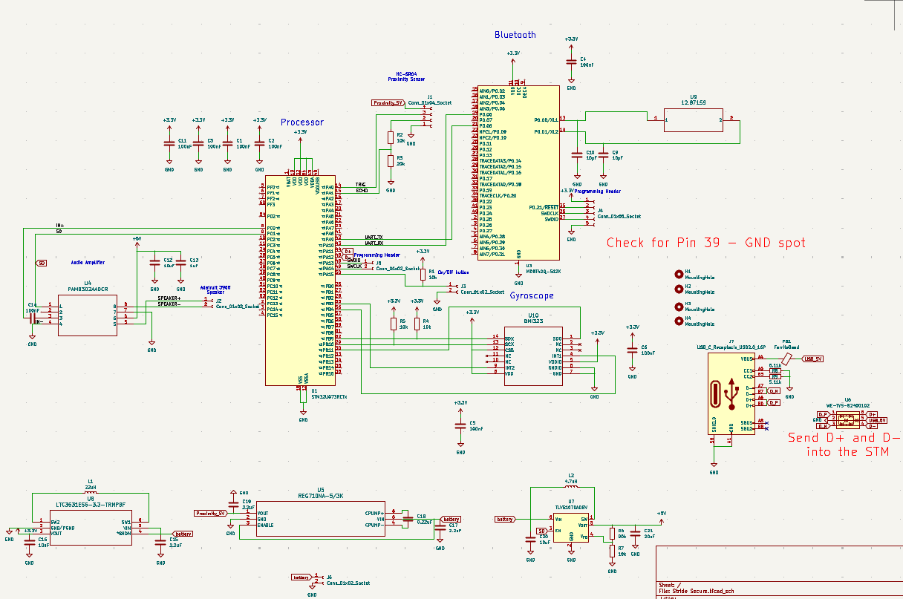
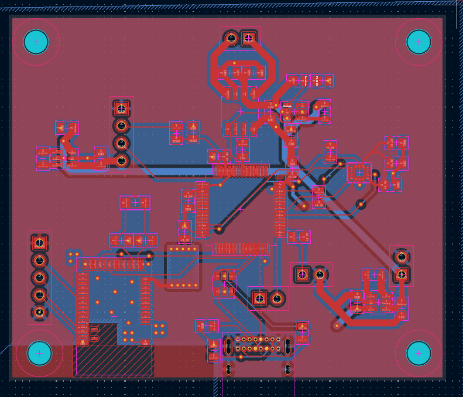
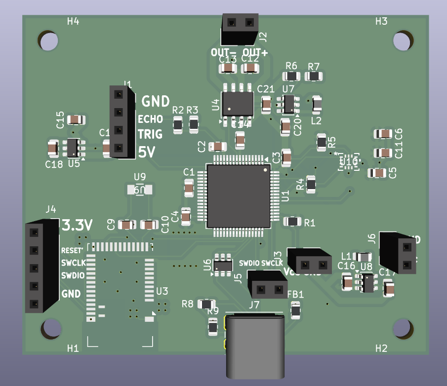

# Stride-Secure

## Abstract
Stride-Secure is a walker assistance project designed to integrate embedded systems, hardware, and software to support users through proximity sensing, device configuration, and usage tracking.

## Overview of the Repository
The repository is organized into several directories, each dedicated to a specific component of the Stride-Secure system.

### BleControl
Contains the ble features chat gave me.

### code
Contains the software and embedded code developed for the project.

#### `breadboardDemo/`
The breadboard demonstration uses an Arduino Due development board to interface with an HC-SR04 ultrasonic proximity sensor and an LED.

The microcontroller sends trigger signals to the sensor and estimates the distance to an object by measuring the time taken for the reflected ultrasonic signal to return. Based on the measured distance, the LED flashes at an increasing rate as the detected object moves farther away.

#### `mobileApp/`
The mobile application provides a user interface (UI) designed to support both Android and iOS devices. Users will be able to:

- View statistics and data related to their daily walker usage.
- Configure initial thresholds and device settings.
- Access relevant usage information to monitor their activity.

#### `webApp/`
The web application provides a browser-based version of the mobile application's user interface. It is intended to offer the same core features, including usage statistics, threshold configuration, and device settings.

#### `firmware/`
Contains the embedded software intended to run on the microcontroller onboard the walker assistance device.
Firmware development will continue once the necessary hardware components become available.

### `kicad/`
Contains the KiCad design files for the project's printed circuit board (PCB), including the schematic, PCB traces, and component footprints.

#### Schematic
The electrical schematic illustrates the circuit connections and relationships between the PCB components.

#### PCB Traces
The PCB layout shows the copper traces and routing used to connect the components.

#### 3D PCB Rendering
The 3D rendering provides a visual representation of the designed PCB and its component placement.

### `notebooks/`
The notebooks folder contains the lab notebooks of Nick, Harrison, and Janine as per the senior design course guidelines.
